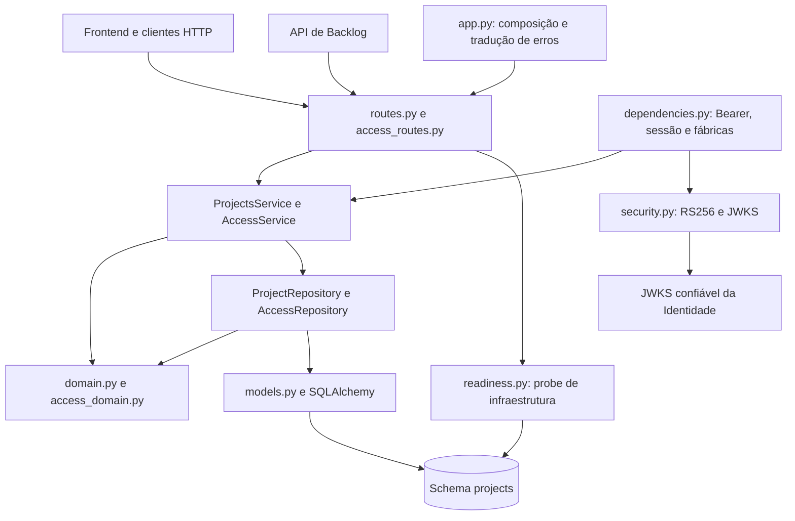

# Arquitetura do serviço de Projetos

O sistema usa microsserviços de Identidade, Projetos e Backlog, consumidos pelo
Frontend. Este repositório organiza o serviço de Projetos em camadas, preservando
os módulos atuais. Somente o schema próprio `projects` é acessado; identidade e
histórias não têm tabelas ou chaves estrangeiras neste banco.



## Responsabilidades e dependências

| Camada | Módulos | Responsabilidade |
| --- | --- | --- |
| Apresentação | `routes.py`, `access_routes.py` | Entrada/saída HTTP, parâmetros, paginação e respostas; sem SQL, ORM ou montagem de repositórios. |
| Aplicação | `service.py`, `access_service.py` | Casos de uso, autorização por ação, expiração, proteção do proprietário e ciclo de convites. Não importa FastAPI, SQLAlchemy nem modelos ORM e não acessa sessões. |
| Domínio | `domain.py`, `access_domain.py` | Dados Pydantic, validações, matriz de permissões e erros de negócio. Não importa HTTP, persistência ou configuração. |
| Infraestrutura | `repository.py`, `access_repository.py`, `models.py`, `database.py`, `security.py`, `readiness.py`, `config.py` | Persistência, consultas, bloqueios, conversões, configuração, verificação criptográfica e disponibilidade do banco. |
| Composição | `app.py`, `dependencies.py`, `cli.py` | Montagem de engine/sessões/serviços, dependências HTTP, middleware, tradução de erros e inicialização explícita por CLI. |

Aplicação pode depender dos repositórios concretos nesta arquitetura multicamadas.
Os repositórios retornam `Project`, `ProjectPage`, `Member` e `Invitation`, sem
entregar registros ORM ou expressões SQL. `Invitation` é um snapshot interno sem
código secreto. O hash do código só é persistido pela infraestrutura. A política
de permissões permanece em `AccessService` e na matriz do domínio; a consulta de
visibilidade aplica os filtros de propriedade e vínculo ativo na persistência.

`build_projects_service(session, clock=..., id_factory=...)`, em `dependencies.py`,
compõe os dois repositórios sobre a mesma sessão e injeta `AccessService` em
`ProjectsService`. O construtor interno de `ProjectsService` exige `access` explícito.
Chamadores internos que antes passavam só um repositório usam essa fábrica; os
pontos de injeção de sessão, relógio e UUID permanecem disponíveis.

## Fluxo de mutação e atomicidade

```mermaid
sequenceDiagram
    participant HTTP as Apresentação HTTP
    participant S as AccessService
    participant R as AccessRepository
    participant DB as Banco próprio
    HTTP->>S: Mutação com usuário autenticado
    S->>R: locked_project(project_id)
    R->>DB: Encerra leitura anterior; inicia transação e bloqueia projeto
    R-->>S: Snapshot Project
    S->>R: Consulta vínculo/convite atualizado
    R-->>S: Snapshots de domínio
    S->>S: Autoriza ação e valida regras
    S->>R: Operações explícitas de persistência
    R->>DB: SQL na mesma transação
    alt sucesso
        R->>DB: Commit ao sair do contexto
        S-->>HTTP: Resultado de domínio
    else falha de regra, SQL ou commit
        R->>DB: Rollback
        S-->>HTTP: Erro traduzido pela apresentação
    end
```

`locked_project` usa `SELECT FOR UPDATE` no PostgreSQL e `BEGIN IMMEDIATE` no SQLite.
A leitura anterior é encerrada antes da aquisição do bloqueio para observar os
vínculos confirmados mais recentes. Autorizações, alterações de projeto, vínculos
e convites permanecem sob o mesmo bloqueio até commit/rollback. A aceitação atualiza
o status, insere e descarrega o vínculo e invalida convites pendentes na mesma
transação; uma falha não consome o convite nem concede acesso parcial. A exclusão
mantém o predicado de proprietário no SQL e as cascatas somente no banco próprio.

O Bearer é validado por RS256, issuer/audience e JWKS confiável. Backlog consulta
`GET /projects/{id}/access` com o mesmo Bearer para decidir permissões atuais.
Projeto invisível e inexistente continuam indistinguíveis por 404; ação negada
em projeto visível retorna 403. Erros SQL e indisponibilidade de chaves retornam
503 seguro. Live não consulta banco; ready usa uma função dedicada de infraestrutura.
Startup não executa DDL; `init` e `migrate` continuam operações explícitas.

## Verificação e limites

`tests/test_architecture.py` inspeciona imports por AST, inclusive dentro de
funções, e impede dependências HTTP/ORM no domínio, framework/ORM/sessão na
aplicação e persistência nas rotas. `tests/test_access_repository.py` verifica os
snapshots e que alterar suas listas não altera o armazenamento. A suíte funcional
cobre RBAC, expiração, isolamento, busca literal/paginação, concorrência SQLite,
rollback de convites/vínculos/projetos, JWT/JWKS e migração repetida.

Os testes PostgreSQL e a regressão HTTP com Backlog são opt-in. Sua ausência em
uma execução SQLite não comprova comportamento PostgreSQL nem integração entre
serviços. As evidências específicas de cada execução ficam em
[verification.md](verification.md). Nenhuma mudança de schema, dados ou contrato
HTTP fez parte da separação original de responsabilidades. A evolução funcional
posterior está descrita em [remaining-user-stories.md](remaining-user-stories.md).

## Evolução funcional local — 31/10/2026

CollaborationService mantém políticas de equipes, concessões, alocações, leases
e notificações; RecommendationService coordena snapshots e decisões humanas.
collaboration_routes.py contém somente adapters HTTP; collaboration_domain.py e
recommendation_domain.py validam entradas e saídas sem HTTP ou banco.
collaboration_repository.py devolve snapshots sem objetos ORM à aplicação.
integrations.py contém clientes HTTP da Identidade, Backlog e provider de IA,
injetados por callables em dependencies.py. Os testes de fronteira incluem os
módulos novos e preservam as regras multicamadas descritas acima.

Criação de projeto/evento, alterações de acesso/versão e aprovação de equipe com
outbox/notificações são transacionais. Unicidade por recomendação/destinatário
impede mensagens repetidas; leitura atualiza read_at uma vez, com predicado de
destinatário e read_at IS NULL. delivered_in_app descreve entrega local, sem SMTP.
Falha na gravação de mensagens reverte a aprovação.

Backlog faz callbacks de autorização durante agregações e snapshots. app.py compõe
um pool próprio limitado para access/access-v2/eligibility, com o mesmo schema e
políticas; o pool principal não é aumentado. PostgreSQL limita cada pool a duas
conexões, sem overflow. SQLite em memória compartilha engine. Isso evita
esgotamento circular mantendo locks de aprovação e identidade atual. O lifespan
descarta ambos os engines. Testes reproduzem dois callbacks HTTP simultâneos.

Metadados aditivos ficam em details JSON; estado/versão/congelamento são colunas
próprias. Migrações são explícitas, sem DDL no startup. Dados profissionais só
entram em recomendações pelo diretório opt-in. Uso real de permissões não é
coletado: access_usage permanece unknown, sem inferir ociosidade a partir da idade
do vínculo. Provider real, SMTP e deploy seguem fora desta validação.
