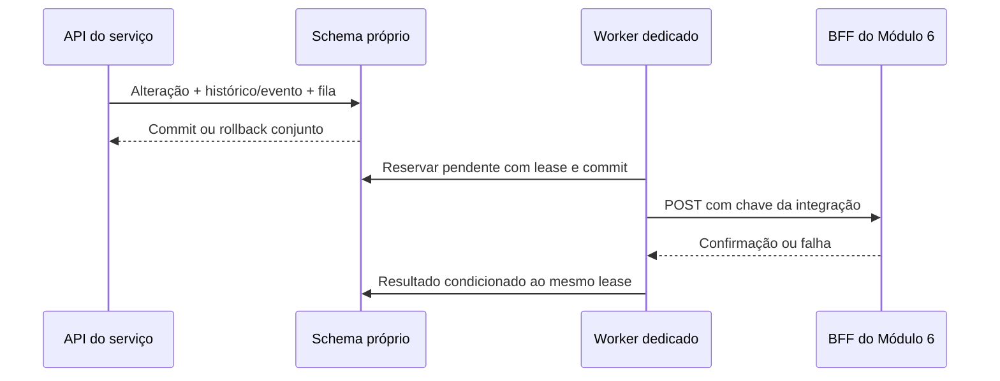

# Notificações para o Módulo 6

Integração optativa entre backends, com uma fila persistente no schema próprio
`projects`. A operação de negócio grava o evento e a entrega pendente na mesma
transação. Um worker separado envia somente eventos confirmados. A disponibilidade
do receptor não participa da transação HTTP de criação ou atualização.

O código está preparado para ativação explícita. A implementação local e os testes
com receptor sintético não significam que notificações reais estejam implantadas.

## Contrato e configuração

Contrato consultado em 15/11/2026 no
[OpenAPI do BFF do Módulo 6](https://software6-bff-2-cnbqhhgdcndzgwdx.chilecentral-01.azurewebsites.net/openapi.json).
O recorte usado pelos testes está em `tests/fixtures/module6-contract.json`.

Destino padrão:
`POST https://software6-bff-2-cnbqhhgdcndzgwdx.chilecentral-01.azurewebsites.net/api/integrations/notifications`.
Headers: `X-Integration-Key` privado e `Content-Type: application/json`.
O worker usa um cliente próprio, sem Bearer de usuário, proxies de ambiente ou
seguimento de redirects. Somente esse endpoint HTTPS é aceito em produção;
HTTP em loopback com porta explícita permite simulação local.

| Variável | Uso |
| --- | --- |
| `MODULE6_ENABLED` | `false` por padrão. Controla captura de eventos e execução do dispatcher |
| `MODULE6_KEY` | Segredo do backend, configurado somente no ambiente privado ou referência de secret do Azure |
| `MODULE6_ENDPOINT` | Endpoint acima; normalmente não precisa ser definido |
| `MODULE6_SOURCE` | Sem padrão na aplicação; nesta instalação, `backlog` representa os eventos compartilhados do Módulo 1 |
| `DATABASE_URL`, `DATABASE_SCHEMA` | As mesmas configurações restritas ao schema deste serviço |

O enum publicado não tem `projects`, `auth` ou `modulo1`. A convenção escolhida
para esta instalação usa `source=backlog` também para os eventos de projetos e
equipes do Módulo 1. Os tipos `project.*` e o prefixo `mod1:projects:` mantêm
a identificação do produtor. Essa escolha não adiciona um novo valor ao enum
do receptor. A aplicação continua exigindo origem explícita para habilitar envio.

A chave fica fora de Git, imagens, comandos compartilhados e configuração do
frontend. Não cole o valor em comandos de histórico do shell. Configure a API e
o worker com o mesmo ambiente e secret. A integração não exige mudança de CORS.

## Eventos

| Operação confirmada | `type` |
| --- | --- |
| Criar projeto | `project.created` |
| Mudar status/ciclo de vida | `project.lifecycle` |
| Arquivar ou restaurar | `project.archived`, `project.restored` |
| Aprovar e aplicar recomendação de equipes | `project.teams.approved` |

Todos usam prioridade `medium`. A aprovação já existente valida a pessoa,
as permissões e o contexto antes de gravar `recommendation.approved`; somente
esse evento confirmado, com `kind=teams`, produz o aviso. Os avisos internos
por destinatário e o estado `delivered_in_app` permanecem independentes.

O identificador é `mod1:projects:<UUID do evento existente>`, persistido como chave
única. O escopo é sempre `project` e `project_id` é o UUID real da operação
autorizada. Mudanças simultâneas de um item geram um único aviso com um corpo
combinado. Não são reprocessados eventos anteriores à ativação.

Mensagens contêm texto fixo, estado e, no Backlog, o identificador do item.
Descrições livres, nomes de pessoas, e-mails, motivos de bloqueio, sugestões de IA,
tokens, chaves e perfis privados não são exportados. `link` fica `null` até haver
um contrato de navegação que o consumidor suporte. Não há anúncios globais.

Rascunhos, rejeições, recomendações vazias, convites privados, revogações, anomalias de acesso e mudanças gerais de equipes não geram avisos externos. A captura não altera a outbox de recomendações existente.

## Fluxo e estados



| Estado | Significado e recuperação |
| --- | --- |
| `pending` | Aguardando envio ou uma conexão que comprovadamente não chegou a enviar; backoff de 30, 60, 120 e 240 segundos |
| `sending` | Reservado por um worker, lease de 60 segundos e token de exclusão |
| `delivered` | HTTP 200 com corpo válido e campos de correlação compatíveis quando presentes |
| `blocked` | HTTP 401, 403 ou 429; corrigir credencial/permissão ou aguardar liberação antes de retry manual |
| `failed` | Redirect/erro 4xx definitivo, ou cinco tentativas de conexão sem envio; corrigir causa antes de retry manual |
| `uncertain` | Timeout/erro após possível envio, 5xx, 2xx inesperado, confirmação inválida ou lease expirado; verificar com o receptor antes de reenviar |

Timeouts HTTP: conexão 5 segundos, demais operações 10 segundos, com prazo total cancelável de 15 segundos para a entrega; confirmação
limitada a 64 KiB. A reserva é confirmada antes do POST e nenhuma transação de
escrita permanece aberta durante a chamada. Workers concorrentes usam atualização
condicional; uma confirmação atrasada não substitui um lease encerrado.

O OpenAPI não documenta deduplicação pelo `event_id`. A chave única protege a
captura local; ela não promete entrega exatamente uma vez no receptor. Um processo
pode cair depois de enviar e antes de persistir o resultado. Nesse caso, o estado
fica incerto, sem reenvio automático. HTTP 200 sem `event_id` continua permitido
pelo contrato; a confirmação de HTTP/corpo não comprova apresentação na Central.

## Preparação e operação

Primeiro, mantenha `MODULE6_ENABLED=false`. Use a credencial administrativa apenas
para a preparação explícita e depois volte à role de runtime do schema próprio:

```console
python -m projects_service.cli migrate
```

A migração é aditiva e idempotente. A API e o worker não executam DDL no startup.
Garanta permissão de DML da role de runtime na nova tabela
`projects.module6_notification_outbox`; não conceda acesso a schemas vizinhos.
Desativada, a captura não consulta essa tabela, preservando o funcionamento de
instalações ainda sem migração.

Configure a chave privada e `MODULE6_SOURCE=backlog`, então habilite captura e worker.
No ambiente virtual instalado pelo projeto:

```console
python -m projects_service.module6_cli status
python -m projects_service.module6_cli list --status uncertain --limit 50
python -m projects_service.module6_cli dispatch --batch-size 50
python -m projects_service.module6_cli run --batch-size 50 --poll-seconds 10
```

O script `projects-notifications` oferece os mesmos subcomandos após instalar o
pacote. `dispatch` termina após um lote de até 100 eventos; `run` mantém polling.
`status` imprime contagens, `list` imprime IDs/estado/tentativas/códigos sanitizados,
sem corpo da notificação. Exit codes: 0 comando executado, 1 configuração/banco
indisponível, 2 envio desativado ou retry não elegível. Um lote executado pode
conter falhas: confira `states` e `list`; exit 0 não afirma entrega de todos.

Depois de corrigir uma falha rejeitada:

```console
python -m projects_service.module6_cli retry mod1:projects:UUID_REAL_DO_EVENTO
```

Para `uncertain`, confira o evento com o receptor e use a opção
`--acknowledge-duplicate-risk` apenas se decidir pelo reenvio. Ela também mantém
o mesmo `event_id`. `delivered` e `sending` não são elegíveis para retry manual.
Não altere o banco diretamente para limpar ou simular entregas.

No Azure, o worker precisa de execução própria: a API pode escalar a zero. Use
a mesma imagem do serviço e sobrescreva o comando com
`python -m projects_service.module6_cli run`, em um worker dedicado, ou agende execuções
de `dispatch` em um Container Apps Job. Não exponha ingress para o worker.
Migração, publicação da imagem, criação/agendamento do worker e teste real em um
projeto combinado são etapas de ativação; os testes locais não as executam.
Preserve as configurações de CORS/JWT/e-mail existentes ao preparar a revisão.

## Validação reproduzível

```console
python -m pytest tests/test_module6_notifications.py -q
```

Os testes exercitam os casos de uso existentes, rollback, deduplicação local,
dois workers, expiração, respostas malformadas, erros 4xx/5xx e diferenças entre
falhas anteriores ao envio e resultado incerto. Um receptor TCP de loopback recebe
o POST do worker real e confirma a persistência da entrega. Credenciais e dados
são sintéticos, sem abrir banco remoto nem enviar eventos ao BFF real.

As falhas simuladas representam a política do nosso emissor; não comprovam como
o BFF real deduplica, persiste ou reage a esses casos. Para ativar, confirmar com
o Módulo 6 o tratamento de `event_id` repetido, timeout após persistência, retenção
e visibilidade de eventos por projeto. A origem configurada nesta instalação é
`backlog`, com os eventos de Projetos identificados pelo campo `type`.

Verificação local em 15/11/2026: 51 testes específicos da integração
aprovados; suíte completa com 338 aprovados e 11 ignorados.
Ruff, formatação, mypy e construção de wheel/sdist aprovados.
O caso HTTP com o checkout separado do Backlog passou em execução adicional
com `BACKLOG_SERVICE_PATH` configurado; os demais casos ignorados dependem de
PostgreSQL local descartável.

O workflow de Projetos recebe as variáveis `MODULE6_ENABLED=true` e
`MODULE6_SOURCE=backlog` do Environment `demo`, e `MODULE6_KEY` como secret.
O worker de Projetos usa um container separado dentro do próprio Container App,
com réplica mínima um. O processo não recebe ingress, compartilha a imagem da API
e acessa somente o schema `projects`. Veja [operação Azure](deploy-azure.md).
