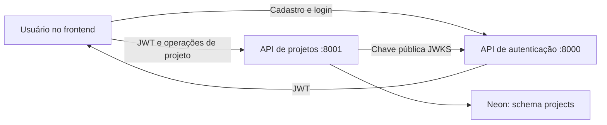

# MVP de projetos do Brian

## Objetivo e recorte aprovado

Permitir que o usuário que acabou de criar uma conta no módulo de autenticação organize seu primeiro projeto e encontre os dados ao entrar novamente. A demonstração será local, com dados persistentes no Neon.

O recorte solicitado é criar, listar e consultar projetos. Quem cria será o responsável e terá acesso aos próprios projetos. A evidência central será: usuário A cria um projeto, consulta seus dados e o encontra após reinício; usuário B não consegue consultar o projeto de A.

Repositório: `https://github.com/briankfreire/projeto_eng_soft.git`. O conteúdo inicial tem apenas `main.py` e `teste.py`, com instruções de impressão, README e atributos do Git. Não existe aplicação nem suíte para ampliar. A implementação substituirá os scripts de demonstração na branch `feat/projects-mvp`, preservando o histórico da main.

## Abordagens consideradas

| Abordagem | Consequência |
| --- | --- |
| Serviço separado com responsável único por projeto | Menor recorte que demonstra organização e isolamento entre contas. É a opção escolhida para este MVP. |
| Serviço separado já com equipes, convites e papéis | Atende colaboração entre pessoas, mas exige decisões e fluxos adicionais. Será uma evolução do módulo. |
| Projetos dentro da API de autenticação | Compartilha implantação, mas mistura responsabilidades que já foram divididas entre os grupos. Não atende a organização escolhida para os repositórios. |

## Componentes

- **Autenticação existente:** contas, cadastro, login RS256 e publicação de JWKS. Nenhuma mudança em seu contrato é necessária para projetos.
- **API de projetos neste repositório:** Python 3.12, FastAPI, SQLAlchemy e psycopg. Rotas delegam criação/consulta aos serviços e repositórios. Pacote `projects_service`.
- **Persistência:** PostgreSQL do Neon, com schema `projects`, tabela de projetos e role runtime próprios. Schema e role não terão acesso às tabelas de autenticação.
- **Interface de demonstração:** ampliar o repositório separado MOD1-Frontend, reutilizando a sessão em memória e a identidade visual do módulo 6. O portal definitivo permanece sob responsabilidade do módulo 6.

## Modelo de dados

Tabela `projects.projects`:

| Campo | Regra |
| --- | --- |
| `id` | UUID gerado pelo serviço |
| `owner_id` | UUID da claim `sub` validada, definido exclusivamente pelo servidor |
| `name` | Texto aparado, 1 a 120 caracteres |
| `description` | Texto opcional, padrão vazio, até 2000 caracteres; permite quebras de linha |
| `created_at` | Data/hora UTC definida pelo servidor |

Não há FK para usuários, porque identidade e projetos são serviços independentes. Índice por responsável/data/UUID apoiará a listagem. Nomes repetidos são permitidos; cada projeto tem seu próprio UUID. Projetos não armazenam e-mail, senha ou papel global do usuário.

## Contrato HTTP

Todas as operações de projetos exigem `Authorization: Bearer <JWT>`.

| Método e rota | Comportamento |
| --- | --- |
| `POST /projects` | JSON `name` e `description`; retorna 201 com os cinco campos do projeto |
| `GET /projects?limit=20&offset=0` | Retorna `items`, `total`, `limit` e `offset`; somente projetos do usuário autenticado, ordenados por data e UUID decrescentes |
| `GET /projects/{project_id}` | Retorna o projeto quando pertence ao usuário; retorna 404 tanto para projeto inexistente quanto para projeto de outra pessoa |
| `GET /health/live` | 200 quando a aplicação está rodando; independente de banco e JWKS |
| `GET /health/ready` | Confirma acesso à tabela própria; 200 ou 503, sem expor configurações |

`limit` deve ser de 1 a 100; `offset` deve ser não negativo. Campos extras no cadastro, inclusive `owner_id`, são recusados. Validação também acontece no backend. Respostas de projeto usam `Cache-Control: no-store`.

Falhas: 401 para token ausente/inválido/expirado, 404 para consulta não disponível ao solicitante, 422 para entrada inválida e 503 para indisponibilidade do banco ou fonte de chaves necessária. Nenhum erro contém JWT, DSN ou detalhes internos de SQL.

## Identidade e autorização

A API de projetos verifica assinatura RS256 com a chave pública do JWKS configurado, issuer exato `mod1-auth-local`, audience exata `engenharia-software-api`, expiração, emissão e UUIDs de `sub`/`jti`, conforme o contrato existente. O endereço de JWKS vem da configuração, nunca de claims ou headers do token. HTTP será aceito somente em loopback para desenvolvimento.

O cliente JWKS terá cache limitado e timeout. Uma chave válida em cache pode continuar validando assinaturas dentro das regras de expiração; sem uma chave confiável utilizável, a operação será recusada. O serviço nunca recebe ou copia a chave privada de autenticação.

Toda consulta ao banco filtra `owner_id` no servidor. O responsável nunca vem do formulário nem de uma query string. Este MVP identifica o criador como responsável, sem atribuir ainda papéis PO/PM/desenvolvedor.

Desativar a conta impede login e `/auth/me` imediatamente no módulo de identidade; como já documentado, um JWT emitido pode continuar aceito em consumidores até expirar. Este serviço não acrescenta revogação ou consulta de identidade em toda requisição.

Para o backlog futuro, Igor poderá consultar o projeto com o mesmo Bearer. Apenas uma resposta 200 permitirá prosseguir para operações naquele projeto; equipes e autorização compartilhada poderão evoluir este contrato depois.

## Banco e execução local

Variáveis da API de projetos: `DATABASE_URL`, `DATABASE_SCHEMA=projects`, `JWT_ISSUER`, `JWT_AUDIENCE`, `JWKS_URL=http://127.0.0.1:8000/.well-known/jwks.json` e `CORS_ORIGINS=["http://127.0.0.1:5173"]`.

O Neon pode ser o mesmo projeto hospedado já configurado, com um novo schema e credencial runtime limitada a USAGE no schema e SELECT/INSERT na tabela. A preparação usa a conexão administrativa somente em operação explícita. A API inicia com a conexão runtime, sem criar tabelas ou roles no startup. TLS verifica certificado e hostname. Configurações reais ficam em arquivos ignorados.

A CLI administrativa terá `projects-service init` para preparar o schema inicial. A rotina de provisionamento deverá gerar/verificar as permissões da credencial dedicada e registrar somente resultados sem segredos. Alterações futuras de estrutura exigirão migração explícita.

API de autenticação: porta 8000. API de projetos: 8001. Frontend: 5173. O frontend ganha configuração pública `PROJECTS_API_BASE_URL`, contendo somente a URL do serviço. As três aplicações serão iniciadas separadamente com instruções reproduzíveis. A implementação não inclui publicação Azure ou mudança do banco de autenticação.

## Fluxo visual

Após o login, a pessoa abre **Meus projetos**. A tela apresenta uma lista dos seus projetos e a ação **Criar projeto**. Sem projetos, explica como começar. O formulário pede nome e descrição; os erros ficam junto aos campos. Após criar, a lista mostra o novo item e permite consultar o detalhe com nome, descrição e data de criação.

Navegação oferece retorno à conta e saída. Loading bloqueia envio duplicado, 401 encerra a sessão local, falha de conexão mantém um estado recuperável e erro de projeto indisponível não revela dados de outra conta. Respostas atrasadas após sair ou trocar de sessão não podem preencher a tela anterior. Dados de projeto são renderizados como texto.

Preservar tokens, fontes, temas claro/escuro e navegação por teclado do frontend atual. Não acrescentar um novo sistema visual ou outro frontend neste repositório de backend.

## Verificação e evidências

Testes serão escritos antes da implementação de cada comportamento e usarão dados/chaves sintéticos. Casos essenciais:

- Projeto criado recebe responsável da identidade validada e nome aparado.
- Campos inválidos ou tentativa de definir responsável pelo cliente são recusados.
- Listagem e consulta de A não expõem projetos de B; UUID conhecido de outro responsável retorna 404.
- Paginação e ordenação são estáveis e incluem somente projetos próprios.
- Tokens inválidos, expirados ou com issuer/audience/algoritmo indevidos são recusados.
- Falhas de JWKS/banco não permitem acesso e retornam respostas seguras.
- Persistência após reinício e comportamentos de live/ready.
- Frontend: criar/listar/consultar projeto, envio único, vazio/erro, teclado, saída e resposta atrasada.

Suítes rápidas poderão usar SQLite isolado. Integração PostgreSQL descartável, quando disponível, terá guard contra hosts remotos. Uma demonstração separada no Neon usará apenas projetos e contas sintéticos próprios, sem remover schemas existentes. Evidências de PostgreSQL, navegador, build e eventual deploy serão registradas separadamente.

Critério de conclusão do MVP: usuário cria conta, entra, cria projeto pelo navegador, consulta e encontra o mesmo projeto após reiniciar o serviço; uma segunda conta não acessa os dados da primeira. Documentação e capturas acompanham os testes reais.

## Evoluções posteriores

Equipes/convites/papéis por projeto, edição e exclusão, backlog/atividades e publicação remota pertencem a etapas posteriores. Este recorte entrega o serviço de projetos com responsável único e pontos de integração claros.

## Git e coautoria

Todo commit criado por Caue/Codex neste trabalho inclui `Co-authored-by: Brian Freire <briankfreire@outlook.com>`, conforme o e-mail informado pelo usuário. O clone local possui hook para acrescentar esse trailer sem duplicá-lo ou remover outros coautores. `AGENTS.md` registra a regra para os próximos clones. A main remota e os commits anteriores não são reescritos.

Desenho e plano aprovados e implementados com execução nativa do Superpowers. Evidências e limites em docs/verification.md. Buscas de JWKS têm intervalo mínimo de 30 segundos, inclusive após falhas, preservando o cache de 300 segundos e a verificação independente de chaves conhecidas.
